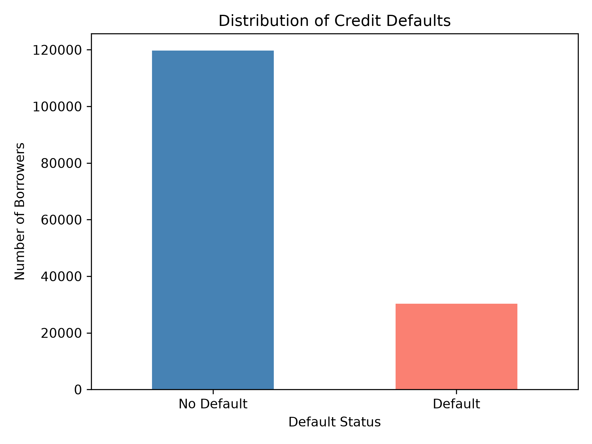

# Credit Scoring — Machine Learning Project

## Project Description

This project aims to predict credit defaults using
machine learning techniques.

The main objectives are:
- Explore and analyze credit data.
- Identify patterns associated with credit defaults.
- Prepare data for machine learning.
- Train and evaluate classification models.
- Compare different ML algorithms.

## Dataset

Source: [Hugging Face](https://huggingface.co/datasets/RPD123-byte/credit-risk-datasets)

The dataset contains:
- 150,000 observations
- 20 columns
- 19 input features
- 1 target variable (`default`)

Target variable:
- `0` — No default
- `1` — Default

## Technologies

- Python
- Pandas
- Matplotlib
- Scikit-learn (planned)
- Git

## Project Progress

- [x] Dataset loading
- [x] Initial data exploration
- [x] Data types analysis
- [x] Missing values analysis
- [x] Target distribution analysis
- [ ] Descriptive statistics
- [ ] Feature analysis
- [ ] Data preprocessing
- [ ] Logistic regression baseline
- [ ] Model evaluation
- [ ] Model comparison

## Initial Findings

### Missing Values

Missing values were found in three features:

| Feature | Missing Values | Percentage |
|---------|---------------:|-----------:|
| emp_length | 8,643 | 5.762% |
| dti | 36 | 0.024% |
| revol_util | 101 | 0.067% |

### Target Distribution

| Class | Count | Percentage |
|-------|------:|-----------:|
| No Default (0) | 119,727 | 79.818% |
| Default (1) | 30,273 | 20.182% |

The dataset contains imbalanced classes.

A model that always predicts the majority class
would achieve approximately 79.82% accuracy
on the full dataset.

Therefore, accuracy alone is not sufficient
to evaluate the model's ability to detect defaults.

### Target Distribution Visualization

## Current Status

Exploratory Data Analysis (EDA) is in progress.